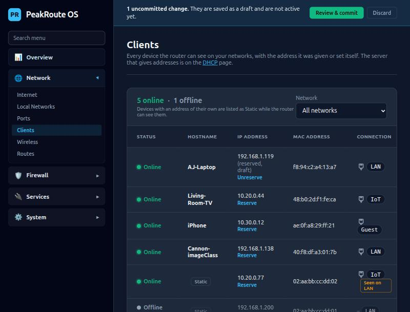
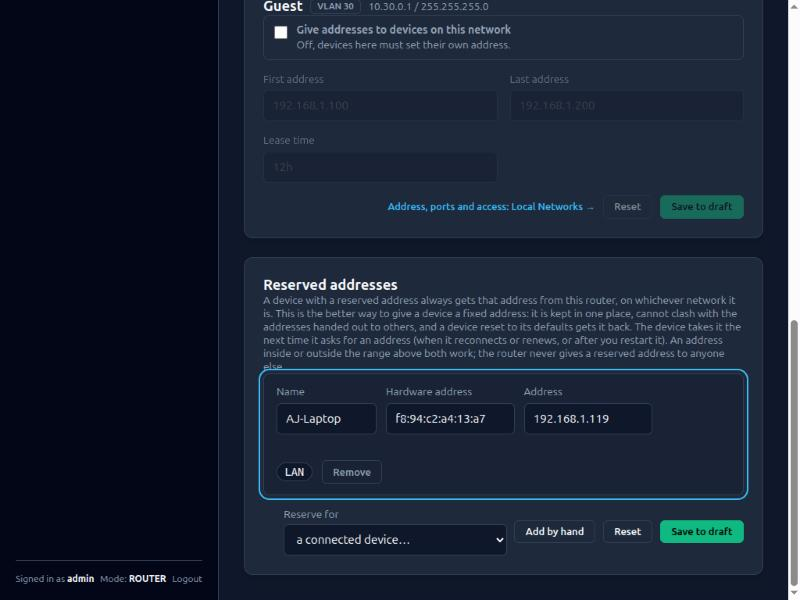

# DHCP and reserved addresses

Contents: 1 The DHCP page, 2 Reserved addresses, 3 What is written, 4 Internals, 5 Not planned.

## 1. The DHCP page

**Services > DHCP.** One card for each local network (the default LAN and every VLAN): the DHCP server's switch, the first and last address
it hands out and the lease time. These are the same settings as on the Local Networks page (each network's own card has them too); both
pages save to the draft and both are committed from the bar at the top. The devices on your networks are listed on
**Network > Clients**, with the network each is on and, for a device that has an address of its own, the tag **Static** (below).

### Nicknames

The pencil beside a device's name on the Clients page gives it a **nickname**, shown first (and on the Overview's Top Clients), with the
name the device gives itself underneath in small type. Type the name and press Enter (Escape cancels; an empty name removes the nickname).
A nickname is only a label on the router's own pages: it is saved at once, with no draft and no commit, and it changes nothing in the
system: it is not the DNS name (a reserved address has its own name for that) and is not sent to the device. It is kept by hardware
address, so it follows the device whatever address it has, and a device that is not connected keeps it. Up to 40 characters, any script,
no control characters; up to 2000 devices. Only administrators can set one. **Not in a backup** (it is in `client_names.json` in the
router's configuration directory): a restore onto a new router starts without nicknames.

### Devices with an address of their own

The Clients page lists the devices that have a DHCP lease, and also those the router can see on its networks that did not ask it for an
address: a printer or server set up with a fixed address on the device itself. They are marked **Static**, have no host name (the router
was never told one) and no lease time, and are shown while the router's neighbour table has them (the router sees a device once it has
exchanged ARP with it, so a device that has been silent for a while can drop off the list, and appears again when it talks). Online or
offline is found the same way as for the others. A device whose address belongs to one network but that the router sees on another (a
device plugged into the wrong VLAN, or with a wrong fixed address) shows an amber **Seen on <network>**. A static device can be given a
reserved address too (below), after which it can be switched to DHCP on the device.

## 2. Reserved addresses

A reserved address is the router-side way to give a device a fixed address, and the better one: the address is kept in one place, cannot
clash with the addresses handed out to other devices, and a device that is reset to its defaults gets it back. The device is known by its
hardware (MAC) address and always gets that address from the DHCP server of the network the address is in, whichever of that network's
ports or Wi-Fi it comes in on. It takes the address the next time it asks (when it reconnects or renews its lease, or is restarted).

- Add them under **Reserved addresses** on the DHCP page: pick a connected device (its current address is kept), or add one by hand.
  On the Clients page a **Reserve** link on a device opens the same page with it filled in. A device that has one shows **Reserved**
  (and, if it still holds another address until it asks again, *will move to ...*).
- A row has an optional **name** (the host name the router's DNS knows the device by), the **hardware address** (any of `aa:bb:...`
  or `aa-bb-...`, written the first way) and the **address**. The network shown beside it is the one the address is in.
- The rules, checked when it is saved and again when committed: the hardware address is a real device address (not a group address),
  listed once; the address is a host address inside one of your local networks, not that network's own address, not its network or
  broadcast address, and used once; **the DHCP server of that network must be on**; the name is a host name (letters, digits and hyphens),
  used once. An address inside the dynamic range works too: the server never gives a reserved address to anyone else.
- A change is committed like any other (it restarts only the DHCP server, for a moment). A network cannot be deleted, have its DHCP
  server switched off or be moved to another subnet while a device still has an address reserved in it: the edit is refused at once and
  names the address (change or remove the reservation first).
- The Clients page shows *Reserved* from what is **committed**; a reservation in the draft is shown in the review and on the DHCP page.

## 3. What is written

`/etc/dnsmasq.d/peakroute-dhcp.conf` gets one line per reservation after the ranges: `dhcp-host=<mac>,<address>[,<name>]`. A router
with no reservations gets exactly the file it always had.

## 4. Internals

`config.Reservation` (`internal/config/reservations.go`: type and `validateReservations`), the list is `NetworkConfig.Reservations`
(`network.json` key `reservations`), diffed by `diffReservations` (one change per device), rendered by `writeReservations`
(`translator`, with `ensureSafeReservations` as a second look), served by `GET`/`PUT /api/v1/dhcp/reservations` (`netapi/reservations.go`:
the whole list is replaced, like the routes; only its own errors block a save). `network.LabelNetworks` marks the leases `reserved`.
The page is `web/static/scripts/dhcp_server.js`, the link on the Clients page `leases.js`.

## 5. Not planned

Reserving an address for a device by name or by client identifier instead of the hardware address (a device that changes its hardware
address, such as a phone with a private address per network, needs one reservation per network) · IPv6 · importing a list.
